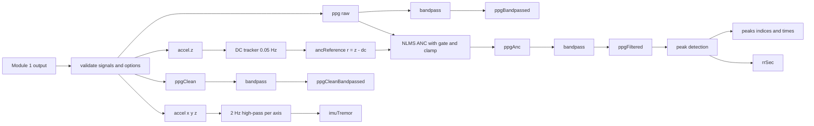

# Design Document: Module 2 - Signal Processing Core

> EDUCATIONAL SIMULATION ONLY. All data is synthetic. This is NOT a medical device and makes no clinical claims.

## Overview

Module 2 conditions the synthetic PPG and accelerometer signals of Module 1 the way a small wearable could, and finds pulse peaks. It is a set of pure, deterministic functions with no UI. The public entry point is `processSignals(signals, options?)` in `src/dsp/index.js`.

Pipeline summary:

- PPG: raw `ppg` goes through an optional NLMS adaptive noise canceller (ANC), then a causal 0.5-4 Hz bandpass, then peak detection.
- IMU, path 1 (tremor features): a causal 2 Hz high-pass per axis gives `imuTremor`.
- IMU, path 2 (ANC noise reference): gravity/DC is removed from the z axis with a slow tracker, and nothing else is removed.
- Evaluation: a pure helper compares detected peaks with Module 1's ground-truth `beatTimes`. A script prints reported (not asserted) metrics.

Module 1 decisions carried over: `Float64Array` for every signal, index, and time array; no input mutation; determinism; `fs` an integer in 25..256; `TypeError` / `RangeError` with field-named messages; the disclaimer steering doc. Module 2 has no randomness. If randomness is added later it must use `createRng(deriveSeed(seed, label))`.

Out of scope: UI integration (a future module) and feature extraction from `imuTremor`, for example band power (a future module). All constants are illustrative simulation values and provisional design targets.

No research was needed beyond the fixed design decisions below; the filter design uses the standard bilinear transform with prewarping and the RBJ audio-EQ-cookbook biquad form, and the ANC uses textbook NLMS (mean-square stable for 0 < mu < 2).

## Architecture



Files (all new, under `src/dsp/` unless noted):

| File | Responsibility |
|---|---|
| `biquad.js` | One biquad section: transposed Direct Form II, steady-state init, frequency response, pole radius, impulse-response L1 norm |
| `butterworth.js` | 2nd-order Butterworth low-pass / high-pass design (bilinear, prewarped, RBJ form) |
| `bandpass.js` | PPG cascade (0.5 Hz high-pass then 4 Hz low-pass), L1 bound, group delay |
| `dcTracker.js` | One-pole DC tracker and reference `r = z - dc` |
| `imuConditioning.js` | 2 Hz high-pass per axis (`imuTremor`) and the reference path wrapper |
| `anc.js` | NLMS canceller with centred window, gate, weight clamp, meta |
| `peaks.js` | Peak detection and RR series |
| `evaluate.js` | Beat matching against `beatTimes`, `windowedMse` |
| `index.js` | `processSignals`: validation, assembly |
| `README.md` | Module docs, opens with `DISCLAIMER_TEXT` |
| `scripts/beat-metrics.js` | Reported metrics over a fixed grid (npm script `metrics`) |

### Design Decisions

#### Decision A: PPG bandpass

"4th order" is defined exactly as a cascade of two biquad sections: a 2nd-order Butterworth high-pass at 0.5 Hz followed by a 2nd-order Butterworth low-pass at 4 Hz. Each section has Q = 1/sqrt(2) and is designed with the bilinear transform and frequency prewarping, `K = tan(pi * fc / fs)`, in the RBJ-cookbook form, and implemented in transposed Direct Form II in double precision. The cascade has 4 poles and 4 zeros.

This is not the same filter as a "4th-order Butterworth bandpass" obtained by the low-pass to bandpass transform of a 2nd-order prototype. That filter also has 4 poles, but its shape differs: its two band edges are coupled and its Q depends on the bandwidth. The cascade was chosen because each edge is then set independently, each section is a well-conditioned second-order section, and the edges are exactly -3 dB at the design frequencies for the single sections.

Reasoning for the band: Module 1's pulse has a heart-rate fundamental of 0.67-3 Hz (40-180 bpm), and the respiratory wander is at 0.25 Hz with amplitude 0.05. A 0.5 Hz high-pass attenuates the wander; a 4 Hz low-pass attenuates noise above the heart-rate range and keeps the fundamental and first harmonic for most heart rates.

Causal filtering reflects an edge device. Group delay is reported (`meta.bandpass.groupDelaySecAt1Hz`, from the numerical phase derivative of the cascade) and not removed.

Stability for every integer `fs` in 25..256: both cutoffs are below Nyquist (4 Hz < 12.5 Hz at `fs` = 25), and the bilinear transform maps the stable analog poles inside the unit circle. The worst case is the 0.5 Hz high-pass at 256 Hz, whose pole radius is close to 1 (about 0.991) but below it. An exhaustive unit test computes each section's pole radius for every integer `fs` from 25 to 256.

Initial state: each section starts in the steady state for a constant input equal to its first input sample. For a TDF2 section with DC gain `G` and constant input `x0`, the steady-state outputs and states are `y0 = G * x0`, `z2 = (b2 - a2 * G) * x0`, and `z1 = (b1 - a1 * G) * x0 + z2`. For the cascade, the high-pass section then outputs exactly 0 from the first sample, so the low-pass section starts at rest, and no start-up step occurs. A residual transient remains (a few seconds at 0.5 Hz, because the signal itself leaves `x[0]`), so evaluation uses a warm-up window.

Boundedness: for any input `x`, `|y[n]| <= L1(h) * max|x|`, where `L1(h) = sum |h[n]|` of the cascade impulse response, computed numerically until `|h[n]|` stays below 1e-12 for one second of samples. The bound also holds with the steady-state initialization, because that equals a constant pre-history with the same maximum. Tests use a tolerance of 1e-9 relative plus 1e-12 absolute for the truncated tail.

#### Decision B: IMU conditioning, two separate paths

Path B1 (tremor features): a 2nd-order Butterworth high-pass at 2 Hz, causal, same biquad machinery, applied per axis to give `imuTremor {x, y, z}`. Its purpose is to isolate tremor-band (3-6 Hz) content for later feature extraction. At 0.5 Hz the steady-state gain is about 0.062; at 4 Hz it is about 0.970. Feature extraction itself (for example band power) is out of scope.

Path B2 (ANC noise reference): removes only gravity/DC and does not apply the 2 Hz high-pass. Module 1's artifact is `artifactGain * 2.0 * lowpass8Hz(accel.z - g_z)`, a zero-phase 8 Hz single-pole low-pass (Module 1 R6.1). It therefore contains the full dynamic acceleration spectrum up to about 8 Hz, and Module 1's motion component lies at 0.3-2 Hz. A 2 Hz high-pass would remove most of the artifact-correlated energy of the reference, and the ANC could not cancel it.

Module 1 does not output gravity, so the DC part is estimated with a causal one-pole tracker:

```
dc[n] = dc[n-1] + beta * (z[n] - dc[n-1]),   beta = 1 - exp(-2*pi*fDc/fs),   fDc = 0.05 Hz,   dc[0] = z[0]
r[n]  = z[n] - dc[n]
```

Trade-offs: the tracker acts as a one-pole high-pass on `r`, with gain 0.980-0.986 depending on fs (0.9802 at 25 Hz, 0.9840 at 64 Hz, 0.9858 at 256 Hz) and phase lead about 9.5 degrees at 0.3 Hz (the ANC filter can absorb this). The start-up offset decays with a time constant of about 3.2 s and mostly lies below the 0.5 Hz bandpass edge. The reference axis is device z, matching Module 1's artifact model. This is a teaching simplification; a multi-axis reference is a possible extension.

#### Decision C: Adaptive noise cancellation (NLMS)

- Algorithm: normalized LMS. The primary signal `d` is the raw `ppg` (before the bandpass); the reference is `r` from path B2. With tap vector `x_vec`, `y = w . x_vec` and `e = d - y`. The final PPG is `bandpass(e)`, or `bandpass(d)` when the ANC is disabled.
- Update: `w <- w + mu * e * x_vec / (eps + x_vec . x_vec)`.
- Filter length and look-ahead: Module 1's artifact low-pass is zero-phase (non-causal, two-sided kernel, tau = 1/(2*pi*8) = about 20 ms), so a causal FIR cannot model it. The ANC uses a centred tap window over reference samples `n-D .. n+D`, with `D = round(0.1 * fs)` (halves rounded up) and `L = 2D + 1` taps, covering about +-5 tau = +-100 ms. On a device this equals a fixed latency of `D` samples. In the simulation the output stays aligned with the input index; for `n + D >= N` the missing future reference samples are zero. `L` ranges from 7 (`fs` = 25, D = 3) to 53 (`fs` = 256, D = 26).
- Step size `mu = 0.1`. NLMS is mean-square stable for 0 < mu < 2. A small `mu` trades slower convergence (about `L / mu` samples, about 2 s at 256 Hz and up to about 2.8 s at 25 Hz) for lower misadjustment (the PPG pulse is uncorrelated with the reference and acts as noise on the weights).
- Regularization `eps = L * sigmaFloor^2` with `sigmaFloor = 0.01 g`, so a near-silent reference does not cause large steps. Weights start at 0.
- Gate: for sample `n`, the ANC computes the population standard deviation of `r[n - 2*fs .. n - 1]`, the `2 * fs` samples before `n` (the current sample is excluded). The gate is closed for `n < 2 * fs`, so the window is first full exactly at `n = 2 * fs`, matching R8.5. From then on, the gate is closed while the standard deviation is below 0.01 g (the same threshold as Module 1 R6.3 and P8). While the gate is closed, the update is frozen and the output is the primary sample unchanged (`e = d` exactly). Requiring a full window avoids chance openings from the few samples at the start. With `motionIntensity = 0` and `tremorIntensity = 0`, Module 1's accelerometer holds only sensor noise (sigma 0.005 g, clipped at 4 sigma = 0.02 g). The window standard deviation then stays near 0.005 g, plus at most about 0.003 g from the decaying DC-tracker start-up offset. The clipping bounds each sample, but a window's standard deviation can still exceed 0.01 g in principle, so the no-motion behaviour is a statistical target, not a bound for every input. Measurement (a throwaway script outside the repo, gate exactly as defined here, applied to `ancReference(accel.z, fs)` of Module 1 output with both intensities 0): M = 1200 configurations, 900 from a grid (seeds 1..100 x `fs` {25, 64, 256} x `durationSec` {5, 30, 600}, other parameters at defaults) and 300 drawn over the full parameter ranges with `createRng(20240611)`. The minimum `gatedFraction` was m = 1, no configuration had `gatedFraction < 1`, and the largest window standard deviation over all samples `n >= 2 * fs` was 0.00735 g (seed 65, `fs` = 25, `durationSec` = 600, at 199.84 s), a margin of 0.00265 g below 0.01 g. Target: X = floor((m - 0.01) * 100) / 100 = 0.99, used by R9.3 and Property 6. A Property 6 run below 0.99 is a counterexample to report (R16.5); the target is not lowered.
- Safety net: the weight vector norm is clamped, `||w||_2 <= W_MAX = 10`. `meta.anc.weightClampActive` tells whether the clamp ever acted (expected never for valid inputs; tests measure it). Bound for tests: `|y[n]| <= W_MAX * sqrt(L) * max|r|`, hence `|e| <= max|d| + W_MAX * sqrt(L) * max|r|`.
- Convergence test (R8.5): the test primary is noise-free, `d[n] = h . x_vec[n]` with the same zero-padding as the ANC window, for a fixed FIR system `h` inside the tap window with `||h||_2 <= W_MAX / 2`. Then `e = (h - w) . x_vec`, and NLMS with 0 < mu < 2 never increases `||w - h||`. Starting from `w = 0`, `||w - h|| <= ||h||` at every sample, so `||w|| <= 2 ||h|| <= W_MAX` and the clamp never acts. For white input, the expected relative misalignment `E||w - h||^2 / ||h||^2` after `100 * L` adapted samples is about `(1 - mu * (2 - mu) / L)^(100 * L)`, about `e^-19`, far below the 1e-3 power target.
- Definition used by the spec: "no-motion condition" means `motionIntensity = 0` and `tremorIntensity = 0`, because tremor bursts also create artifact in Module 1. The statement "pass-through when motion is 0" is interpreted this way, as the statistical target of R9.3 (`gatedFraction >= 0.99`); the pass-through is exact (within 1e-12 after the bandpass) in runs where the Gate is closed for every sample.
- Gate lag: the gate uses a causal window, so it reacts to the start of motion up to a window length late, and stays open for up to a window length after motion stops. This is documented, not corrected.

#### Decision D: Peak detection and RR

- Input: the final bandpassed PPG (`ppgFiltered`, which is the ANC output after the bandpass when the ANC is enabled).
- Candidates are strict-rise local maxima. A candidate is accepted when its amplitude is positive and at least 0.5 times the running maximum of the signal over the previous 3 s (causal). The threshold suppresses the diastolic bump (amplitude 0.35 of systolic in Module 1).
- Refractory period: `max(0.3 s, 0.6 * median of the last up to 5 accepted RR intervals)`. 0.3 s matches Module 1's RR minimum of 300 ms. The refractory test uses the interpolated candidate time, so `rrSec >= 0.3 s` holds by construction (up to a floating-point tolerance of 1e-9).
- Parabolic interpolation of the peak time (default on, option `peakInterpolation`): with samples `ym1, y0, yp1` around index `n`, `delta = 0.5 * (ym1 - yp1) / (ym1 - 2*y0 + yp1)` with `delta` in (-0.5, 0.5); the denominator is strictly negative at a strict local maximum, so no division by zero occurs. The time is `(n + delta) / fs`. Peak times therefore lie inside `[0, (N-1)/fs]`, which is within `[0, durationSec]`.
- Outputs: `peaks.indices` (integer indices as `Float64Array`), `peaks.times` (seconds, strictly increasing), `rrSec` (differences of the times).
- Ground truth and evaluation (pure `evaluateBeats(signals, result)`): true beat onsets are Module 1's `beatTimes`, true RR is `diff(beatTimes)`. The lag is the median over beats of (nearest detected peak time minus beat onset), restricted to [0, 0.6 s]. Each true beat is matched to at most one detected peak within +-0.25 times the median true RR around `onset + lag`. The helper reports TP, FP, FN, sensitivity, PPV, beat-count error, and the RR mean absolute error (ms) over matched consecutive pairs. The Evaluation_Window excludes a warm-up of 2 s at the start and 1 s at the end, and true beats whose expected peak falls outside it.

## Components and Interfaces

All functions are pure. Arrays in and out are `Float64Array`. Inputs are never mutated.

| Component | Interface (description) | Notes |
|---|---|---|
| `designLowpass(fs, fc)` / `designHighpass(fs, fc)` | Return `{b0, b1, b2, a1, a2}` normalized with `a0 = 1` | `RangeError` for `fc` outside (0, fs/2) |
| `filterBiquad(section, x, {steadyState})` | Returns a new `Float64Array` | TDF2, causal; steady-state init from `x[0]` |
| `dcGain(section)`, `magnitudeAt(section, f, fs)`, `poleRadius(section)` | Numbers | Used by tests and `meta` |
| `l1Norm(sections, fs)` | Number | Cascade impulse response until the tail is below 1e-12 for 1 s |
| `bandpassPpg(x, fs)` | New `Float64Array` | 0.5 Hz high-pass then 4 Hz low-pass |
| `bandpassDesign(fs)` | `{sections, groupDelaySecAt1Hz, l1}` | Used for `meta.bandpass` |
| `trackDc(z, fs)` | `Float64Array` dc | `beta` from 0.05 Hz |
| `ancReference(z, fs)` | `Float64Array` r | `r = z - dc` |
| `tremorHighpass(axis, fs)` | New `Float64Array` | 2 Hz, steady-state init |
| `conditionImu(accel, fs)` | `{ancReference, imuTremor: {x, y, z}}` | Wrapper in `imuConditioning.js`; tremor path reads the raw axes |
| `nlmsCancel(d, r, fs)` | `{e, gatedFraction, weightClampActive, taps, lookaheadSamples, mu}` | Gate and clamp inside |
| `detectPeaks(y, fs, {interpolate})` | `{indices, times}` | Rules of Decision D |
| `rrFromPeaks(times)` | `Float64Array` | Differences |
| `evaluateBeats(signals, result, options?)` | Result object (Data Models) | Validates `beatTimes` |
| `windowedMse(a, b, fs, startSec, endSec)` | Number | Equal-length arrays |
| `processSignals(signals, options?)` | Output object (Data Models) | Validation then assembly |
| `computeBeatMetrics(grid)` in `scripts/beat-metrics.js` | Metrics table object | Pure; CLI prints it |

Cost: the filters are O(N); NLMS is O(N x L) with L up to 53, so 600 s at 256 Hz is about 8 million multiply-adds per pass. Full-range property draws are feasible with explicit timeouts.

### Constants

| Name | Value |
|---|---|
| PPG high-pass / low-pass | 0.5 Hz / 4 Hz, Q = 1/sqrt(2) |
| Tremor high-pass | 2 Hz, Q = 1/sqrt(2) |
| DC tracker cutoff | 0.05 Hz |
| ANC window | `D = round(0.1 * fs)`, `L = 2D + 1` |
| `mu`, `sigmaFloor`, `eps` | 0.1, 0.01 g, `L * sigmaFloor^2` |
| Gate window, gate threshold | `r[n - 2*fs .. n - 1]` (the `2 * fs` samples before `n`, current sample excluded; gate closed for `n < 2 * fs`), 0.01 g |
| No-motion `gatedFraction` target X | 0.99 (statistical target; measurement in Decision C) |
| `W_MAX` | 10 |
| Peak lookback, threshold fraction | 3 s, 0.5 |
| Refractory | `max(0.3 s, 0.6 * median of last up to 5 RR)` |
| Evaluation window | start warm-up 2 s, end margin 1 s |
| Match tolerance, lag range | 0.25 x median true RR, [0, 0.6 s] |
| MSE warm-up | 5 s (window `[5 s, durationSec - 1 s]`) |
| Pass-through tolerance | 1e-12 |
| Beat-count tolerance | `max(2, ceil(0.05 * true))` |

## Data Models

Input: a Module 1 output object (`fs`, `durationSec`, `n`, `ppg`, `ppgClean`, `artifact`, `accel`, and `beatTimes` for the evaluator). `processSignals` does not read `beatTimes`, `artifact`, or `meta`.

Options: `{ anc: boolean = true, peakInterpolation: boolean = true }`.

Output of `processSignals`:

```
{
  synthetic: true, fs, n,
  ppgBandpassed,        // bandpass of raw ppg, no ANC
  ppgAnc,               // ANC output e before the bandpass; copy of ppg when ANC is disabled
  ppgFiltered,          // bandpass of ppgAnc
  ppgCleanBandpassed,   // bandpass of Module 1 ppgClean (evaluation only)
  ancReference,         // r
  imuTremor: { x, y, z },
  peaks: { indices, times },
  rrSec,
  meta: {
    anc: { enabled, mu, taps, lookaheadSamples, gatedFraction, weightClampActive },
    bandpass: { sections, groupDelaySecAt1Hz }
  }
}
```

`gatedFraction` (from `nlmsCancel`, reported as `meta.anc.gatedFraction`) is the number of samples with the Gate closed divided by `N`. For a zero-length input (`N = 0`), `nlmsCancel` returns `gatedFraction = null`, the same convention as R14.6. `processSignals` never passes `N = 0`, because R1.5 requires `n >= 1`; with the ANC disabled it reports `null` (R11.3).

Result of `evaluateBeats`: `{ tp, fp, fn, sensitivity, ppv, trueCount, detectedCount, beatCountError, rrMaeMs, lag, lagEstimated }`, with `null` for ratios or means that have an empty denominator.

## Correctness Properties

*A property is a characteristic or behavior that should hold true across all valid executions of a system-essentially, a formal statement about what the system should do. Properties serve as the bridge between human-readable specifications and machine-verifiable correctness guarantees.*

Overlap review: determinism and immutability stay separate because their failure modes differ. Pass-through (gate) and toggle (option) stay separate. The filter bound and the ANC bound stay separate because their constants differ. Beat count (accuracy) and peak structure (invariants) stay separate.

All thresholds below are provisional design targets. If an implementation run violates one, the counterexample must be reported, and the threshold must not be loosened (the same rule as Module 1).

### Property 1: Filter outputs are finite and L1-bounded

*For any* finite input array and any integer `fs` in 25..256, the bandpass output and the 2 Hz high-pass output are finite, and each satisfies `|y[n]| <= L1_Norm * max|x|` (relative tolerance 1e-9 plus 1e-12 absolute).

**Validates: Requirements 5.4, 7.3**

### Property 2: ANC output is finite and bounded

*For any* valid Module 1 output, `ppgAnc` is finite and satisfies `|e[n]| <= max|ppg| + W_MAX * sqrt(L) * max|ancReference|`.

**Validates: Requirements 10.3, 8.1**

### Property 3: Peak and RR structure

*For any* valid Module 1 output, `peaks.times` is strictly increasing with every value in `[0, durationSec]`, `peaks.indices` has the same length with integer values, `rrSec` equals the successive differences of `peaks.times`, and every `rrSec` value is at least 0.3 s minus 1e-9.

**Validates: Requirements 12.5, 13.1, 13.2**

### Property 4: Inputs are never mutated

*For any* valid Module 1 output and options, after `processSignals` the input object and all its arrays (deep-frozen before the call) are unchanged, sample by sample under `Object.is`, and the `options` object is unchanged.

**Validates: Requirements 3.2**

### Property 5: Determinism

*For any* valid Module 1 output and options, two calls of `processSignals` with deeply equal input return deeply equal output.

**Validates: Requirements 3.1**

### Property 6: No-motion gated fraction is at least 0.99, and a fully gated run is a pass-through

*For any* Module 1 parameters with `motionIntensity = 0` and `tremorIntensity = 0` (full ranges for the other parameters, including `fs` in 25..256 and `durationSec` in 5..600), `meta.anc.gatedFraction >= 0.99`; and in every run with `meta.anc.gatedFraction = 1`, `ppgFiltered` equals `ppgBandpassed` with a maximum absolute difference of at most 1e-12. The 0.99 target is statistical, chosen below the measured minimum (Decision C). The tolerance only covers floating-point rounding; with the Gate closed for every sample, `e = d` exactly.

**Validates: Requirements 9.2, 9.3, 9.4**

### Property 7: Disabled ANC is the identity

*For any* valid Module 1 output, with `options.anc = false`, `ppgAnc` equals `ppg` sample by sample, `ppgFiltered` equals `ppgBandpassed` exactly, `meta.anc.enabled` is `false`, `meta.anc.gatedFraction` is `null`, and no output array is the same object as an input array.

**Validates: Requirements 11.2, 11.3, 2.5**

### Property 8: ANC reduces the error under correlated artifact

*For any* Module 1 parameters with `motionIntensity` in [0.3, 1], `artifactGain` in [0.2, 1], and `durationSec >= 20`, `windowedMse(ppgFiltered, ppgCleanBandpassed)` is strictly less than `windowedMse(ppgBandpassed, ppgCleanBandpassed)`, both over `[5 s, durationSec - 1 s]`. The reduction ratio is reported by the Metrics_Script and is not asserted.

**Validates: Requirements 8.1, 8.6, 16.6**

### Property 9: Beat count at no motion

*For any* Module 1 parameters with `motionIntensity = 0` and `tremorIntensity = 0`, `heartRateBpm` in 40..180, `hrvSdnnMs` in 0..150, and `preIctalLikeness` in 0..1, `|detectedCount - trueCount| <= max(2, ceil(0.05 * trueCount))` within the Evaluation_Window, where the counts come from `evaluateBeats`.

**Validates: Requirements 12.1, 12.2, 12.3, 14.5**

### Property 10: Output contract

*For any* valid Module 1 output, `processSignals` returns `synthetic === true`, `fs` and `n` equal to the input, every signal, index, and time array a `Float64Array`, the per-sample arrays of length `n`, `meta` with the documented fields, and `ppgFiltered` equal to the bandpass of `ppgAnc`.

**Validates: Requirements 2.1, 2.2, 2.3, 2.4, 8.6**

## Error Handling

- Validation order in `processSignals`: `signals` type, `fs`, array types, array lengths, `n` / `durationSec` consistency, finiteness, then options. Every message names the field and the valid range or expected type.
- `Biquad_Designer` throws `RangeError` for `fc` outside (0, fs/2). With `fs` validated first, Module 2's own cutoffs never trigger it.
- `Beat_Evaluator` validates `beatTimes` (`TypeError` if not `Float64Array`, `RangeError` if not finite and strictly increasing).
- Degenerate signals (flat, silent, or very short) do not throw: peak detection returns empty arrays, `rrSec` is empty, and evaluation ratios are `null`.
- The weight clamp is a safety net, not an error path; its activation is reported in `meta.anc.weightClampActive`.
- The Metrics_Script exits with status 0 whatever the metric values are, and non-zero only for a runtime error.

## Testing Strategy

Dual approach: unit tests for specific examples, edge cases, and error conditions; property tests (fast-check, already a pinned dependency) for universal properties. Property-based testing applies here because the stages are pure functions of numeric arrays with large input spaces. The ANC and beat-count properties run the Module 1 generator, which is also pure.

Property test rules:

- Each property in this document is implemented by one fast-check property test of at least 40 runs (Module 1's FULL_RUNS) for properties that run the Module 1 generator over the full parameter ranges, and at least 100 runs for properties on small synthetic arrays (Property 1), with an explicit timeout (for example `{ timeout: 60000 }`), in `test/dsp.property.test.js`.
- Each test carries a tag comment: `Feature: signal-processing-core, Property N: <title>`.
- Arbitraries draw from Module 1's parameter table, including the full `fs` range 25..256, biased toward boundary values (`fs` 25 and 256, heart rate 40 and 180, `hrvSdnnMs` 0 and 150, minimum duration).
- No beat-detection score is asserted when `motionIntensity > 0` or `tremorIntensity > 0`; `scripts/beat-metrics.js` measures and prints sensitivity, PPV, count error, RR MAE, and the ANC MSE reduction ratio over a fixed grid of seeds and motion levels, with and without the ANC. These are reported metrics, not pass/fail.
- Thresholds are provisional design targets. If a run violates a property, the counterexample is reported and the threshold is not loosened.

Unit tests (`test/dsp.*.test.js`): biquad coefficients against closed-form values for several `fs`; DC gain 0 for high-pass and 1 for low-pass sections; -3 dB at the cutoffs; pole radius below 1 for every integer `fs` from 25 to 256 (exhaustive); steady-state initialization; DC tracker recurrence, constant-input zero reference, and convergence 30 s after a step; `imuTremor` attenuating 0.5 Hz and passing 4 Hz; NLMS convergence on a known FIR system with a white-noise reference (measured after the gate opens, from sample `2 * fs + 100 * L`); gate pass-through exactness; weight clamp activation; peak detection on simple synthetic pulse trains (including 40 and 180 bpm and a diastolic bump); evaluation matching on hand-made cases; `windowedMse`; validation errors; a metrics smoke test on a reduced grid; and the disclaimer check on `src/dsp/README.md`.

Requirement coverage (R = requirement number):

| Requirement | Verified by |
|---|---|
| R1 validation | Unit tests (`test/dsp.index.test.js`) |
| R2 output contract | Property 10, Property 7, unit test |
| R3 purity | Properties 4 and 5, source scan in unit test |
| R4 biquad | Unit tests (closed form, gain, exhaustive pole radius, steady state) |
| R5 bandpass | Property 1, unit tests (cascade, group delay, meta) |
| R6 DC tracker | Unit tests |
| R7 tremor path | Property 1, unit tests |
| R8 NLMS | Properties 2, 8, 10, unit tests (window, parameters, FIR convergence) |
| R9 gate | Property 6, unit tests |
| R10 clamp | Property 2, unit tests |
| R11 toggle | Property 7 |
| R12 peaks | Properties 3 and 9, unit tests |
| R13 RR | Property 3, unit tests |
| R14 evaluation | Property 9, unit tests (hand-made cases, `windowedMse`) |
| R15 metrics | Smoke test on a reduced grid, manual run of the script |
| R16 testing | Test suite structure above |
| R17 disclaimer | Extended `test/disclaimer.test.js` |
